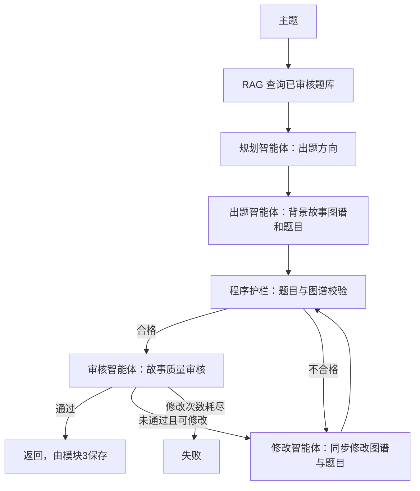

# 模块1 · 出题与审核

四个智能体共用 `contracts.JsonModel`，由 LangGraph 编排：



## 文件职责

- `agents/planner.py`：规划 Agent，输出场景、机制、设计要求，校验后交给出题 Agent。
- `agents/author.py`：出题 Agent，根据规划与参考生成候选图谱和题目。
- `agents/reviewer.py`：审核 Agent，只接收结构合格的候选，审核因果、动机、可推理性及重复。
- `agents/reviser.py`：修改 Agent，根据模型审核意见或护栏错误修复旧候选，返回完整新版。
- `workflow.py`：LangGraph 四角色编排、交接护栏、修改上限和服务端生成记录；不再直接调用模型。
- `kg.py`：`StoryGraph` 图谱构建、校验、节点/出边读取和关系可达查询，不依赖图数据库。
- `guardrails.py`：主题、检索参考、规划、候选和审核协议的程序校验。
- `prompts.py`：四个独立角色提示词；修改角色不复用作者身份。
- `retrieval.py`：本地中文单字/双字与英文词检索，默认取3条，数据源通过回调注入。
- `puzzles.py`：演示题与 `validate_generated()` 题目校验工具，由候选护栏复用。

接口仍为 `PuzzleWorkflow(model, max_revisions=2, retriever=None).generate(theme)`。
输出主体为 `id/title/surface/bottom/key_points/generation`。`generation` 保存审核通过标记、主题标签、规划、最终图谱、参考题ID、审核意见及执行轨迹。

## 背景故事图谱

出题智能体在同一次调用中先组织背景事实再编写题目。候选格式为：

```json
{"story_graph":{"nodes":[{"id":"n1","kind":"人物","text":"故事人物"}],"edges":[]},"puzzle":{"title":"标题","surface":"汤面","bottom":"完整真相","key_points":["事实一","事实二","事实三"]}}
```

图谱节点组织人物、地点、物品、事件、条件和信息；关系组织人物关系、时间先后、动机、因果、知情和发生地点。`kg.py` 检查字段、节点ID唯一、节点/关系类型、端点存在、重复关系和规模上限（1至100个节点、最多300条关系）。图谱仍由出题 Agent 与题目在同一次调用中生成，独立 KG 模块不增加模型调用，也不宣称验证了故事的真实因果。

```python
from module1_puzzles.kg import StoryGraph

graph = StoryGraph(candidate["story_graph"])
node = graph.node("n1")
edges = graph.outgoing("n1", "因果")
consequences = graph.reachable("n1", "因果")
```

## 节点间护栏

主题和检索参考在规划前校验；规划字段、类型和长度在出题前校验。出题和修改的候选先经题目结构与图谱护栏，合格后才交给审核模型；不合格时不调用审核模型，程序产生拒绝意见，沿原来的限次修改路径修复。修改 Agent 是唯一允许接收不合格旧候选的修复入口。最终返回前再次校验，防止不合格候选入库。

审核返回严格验证 `approved` 布尔值与 `feedback` 字符串；非法协议直接失败。`generation.reviews` 同时记录护栏拒绝意见与模型审核意见，轨迹中的 `reviewer` 表示审核关口，不保证该关口每次都产生模型请求。所有角色将输入视为数据；结构护栏不能保证识别全部提示词注入或语义错误，故事质量仍由审核 Agent 判断。

## 题库与 RAG

默认 API 装配注入 `ApprovedPuzzleRetriever(repo.puzzles)`，每次生成重新读取数据库，无需维护独立索引。只有 `generation.approved` 严格为 `true` 的题目可作为参考。新流程通过审核并成功入库后立即可检索；旧题、演示题和导入题未带审核记录时不自动纳入。可从空题库开始，历史题须经过审核后再标记，不按题库存在与否推断审核状态。

参考只含题目字段和标签，不含其他生成记录。规划、出题、审核、修改共享同批参考，不在修改时重复检索。当前为关键词 RAG，无 embedding 或额外模型服务；题库规模增大时可替换检索器。完整答案、图谱、参考ID和审核意见只在服务端保存，不传给队友或浏览器。

默认最多两次修改，正常通过3次模型请求，最多7次；配置最多3次修改时最多9次。结构被护栏拒绝时跳过该轮模型审核，调用数更少。护栏与语义审核都必须通过；离线测试验证协议和流程，不证明实际题目质量。网络或 JSON 解析错误立即失败，无自动重试。
