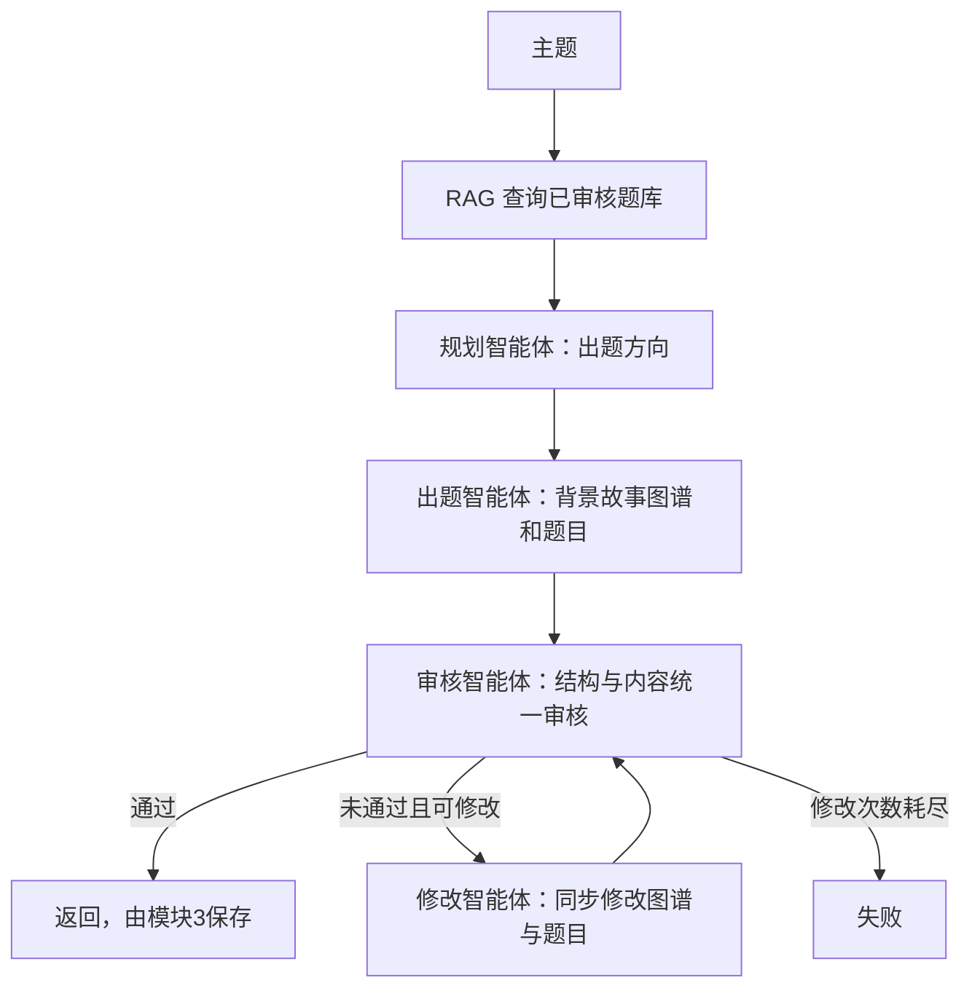

# 模块1 · 出题与审核

四个智能体共用 `contracts.JsonModel`，由 LangGraph 编排：



## 文件职责

- `workflow.py`：检索、四角色编排、修改上限和服务端生成记录。
- `prompts.py`：四个独立角色提示词；修改角色不复用作者身份。
- `retrieval.py`：本地中文单字/双字与英文词检索，默认取3条，数据源通过回调注入。
- `puzzles.py`：演示题及保留的旧 `validate_generated()` 工具；新流程不调用该工具。

接口仍为 `PuzzleWorkflow(model, max_revisions=2, retriever=None).generate(theme)`。
输出主体为 `id/title/surface/bottom/key_points/generation`。`generation` 保存审核通过标记、主题标签、规划、最终图谱、参考题ID、审核意见及执行轨迹。

## 背景故事图谱

出题智能体在同一次调用中先组织背景事实再编写题目。候选格式为：

```json
{"story_graph":{"nodes":[{"id":"n1","kind":"人物","text":"故事人物"}],"edges":[]},"puzzle":{"title":"标题","surface":"汤面","bottom":"完整真相","key_points":["事实一","事实二","事实三"]}}
```

图谱节点组织人物、地点、物品、事件、条件和信息；关系组织人物关系、先后、动机、因果和知情关系。审核智能体检查节点ID、关系端点、结构、长度、逻辑、可推理性和重复；没有独立本地题目结构校验。修改智能体输出完整的新图谱及题目。程序只验证审核控制协议和装配结果，无法解析的模型响应直接失败。

## 题库与 RAG

默认 API 装配注入 `ApprovedPuzzleRetriever(repo.puzzles)`，每次生成重新读取数据库，无需维护独立索引。只有 `generation.approved` 严格为 `true` 的题目可作为参考。新流程通过审核并成功入库后立即可检索；旧题、演示题和导入题未带审核记录时不自动纳入。可从空题库开始，历史题须经过审核后再标记，不按题库存在与否推断审核状态。

参考只含题目字段和标签，不含其他生成记录。规划、出题、审核、修改共享同批参考，不在修改时重复检索。当前为关键词 RAG，无 embedding 或额外模型服务；题库规模增大时可替换检索器。完整答案、图谱、参考ID和审核意见只在服务端保存，不传给队友或浏览器。

默认最多两次修改，正常通过3次模型请求，最多7次；配置最多3次修改时最多9次。结构和内容均由审核模型判断，可能误审，离线测试不能证明实际题目质量。网络或 JSON 解析错误立即失败，无自动重试。
