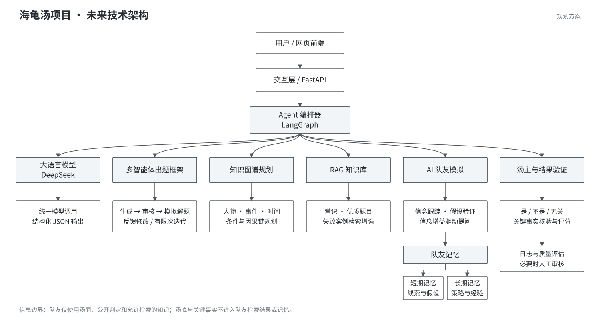

# 海龟汤项目技术栈与技术架构

## 一、技术栈

| 层级 | 主要职责 | 当前实现 | 未来拟采用 |
| --- | --- | --- | --- |
| 前端交互层 | 选题、围桌对话、答案提交与评分展示 | HTML、CSS、JavaScript | 保留现有界面，按需求组件化 |
| API 层 | 请求处理、会话管理与回合控制 | Python 标准库 HTTP 服务 | FastAPI |
| Agent 层 | 出题、队友推理、汤主判断与评分 | 提示词约束与固定流程调用 | LangGraph 多智能体编排；信念状态跟踪、假设验证与信息增益驱动提问 |
| 模型层 | 文本生成、问题判断与事实核验 | DeepSeek 统一客户端、JSON 输出约束 | 继续使用 DeepSeek，按角色优化提示词 |
| 数据与记忆层 | 题库、知识图谱、RAG 检索和队友记忆 | JSON 题库、内存对话历史 | Neo4j 存储因果图谱；PostgreSQL 与 pgvector 存储知识和记忆 |
| 基础设施层 | 运行、测试与部署 | 本地 Python 启动与自动测试 | Docker 部署，补充调用日志和质量评估 |

## 二、技术架构

