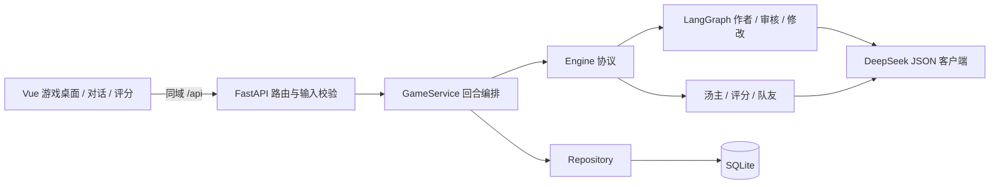

# 技术架构与团队协作约定

本次改写的活动入口是 `code/run.py` 和 `code/module4_frontend`，对应 Vue 3 + Vite、Python + FastAPI、LangGraph、DeepSeek API、SQLite。核心代码按四个业务模块组织，共用客户端与协议位于 `code` 根目录。



## 目录与负责人边界

| 建议分工 | 主要目录 | 交付与边界 |
| --- | --- | --- |
| 模块1：出题 | `code/module1_puzzles` | LangGraph 作者/审核/修改、提示词、结构校验；不访问数据库 |
| 模块2：队友 | `code/module2_teammate` | 公开历史推理、队友提问；不接收汤底和评分事实 |
| 模块3：汤主 | `code/module3_host` | 判题、评分；`api/` 管理 HTTP/用户/回合，`storage/` 管理 SQLite |
| 模块4：前端 | `code/module4_frontend` | Vue 桌面、对话、评分、API 对接；禁止浏览器直连模型 |
| 共享维护 | `code/llm.py`、`code/contracts.py`、`engine.py` | 模型客户端、稳定接口和模块组合，跨模块共同评审 |

四个 module 目录均包含当前运行代码。后端与存储集中在汤主模块的子目录；共享文件负责连接模块，不承载独立业务。各模块实现与测试由对应成员维护，跨模块先确认契约，再分别提交 PR。

## 模块契约

`Engine.generate(theme) -> puzzle` 返回 `id/title/surface/bottom/key_points/generation`；仅审核通过才返回。`question(puzzle,text)` 和 `score(puzzle,text)` 返回判定，评分额外包含 `report`。`teammate(surface,memory,teammate=None,board=None) -> {"question","target","rationale"}` 只额外接收角色的 `id/name/focus` 与公开黑板，不接收私有故事对象；调用方兼容旧的纯字符串返回值。模型调用只经过 `JsonModel.complete_json(system,payload,max_tokens)`。

队友回合的稳定性由三条本地规则兜底，决策记录见 [ADR-0001](../adr/ADR-0001-teammate-question-contract.md)：角色档案（`id/name/focus` 公开，`strategy/dimensions` 只进提示词与分工）在 `module2_teammate` 内注册；新提问与公开历史做命题级比对（剥掉“这和…有关吗”这类提问框架后比 2-gram 余弦，阈值 0.7），命中重复只重试一次，仍重复抛 `DuplicateQuestion`；线索耗尽或连续重复都抛 `TeammateYield`，由 service 转为 `notice` 并把发言权交还玩家，不返回 502。

每局另有一份共享黑板（`module2_teammate/board.py`，见 [ADR-0002](../adr/ADR-0002-teammate-shared-board.md)）：只有 `asked/confirmed/excluded/covered/stalled` 计数，由判题结果与 target 本地推导，不额外调用模型，也不读取汤底。队友档案声明各自负责的维度（小夏=人物/物品，阿澄=时间/因果，小墨=反例/动机），`next_focus` 把「尚未被问过的负责维度」作为本轮 `focus_dimension` 传给模型；演示模式优先挑该维度的未问线索，没有则退回轮换。黑板随 `games.state` 持久化，老存档按空黑板补齐。`confirmed` 计的是「判为正确的命题数」，与 `key_points` 的关键事实数不是同一单位，收敛提示只说「可以尝试提交完整还原」，不宣称已还原完整事实。

Repository 管理会话、公开记忆、题库和游戏快照。创建新局与新题入库同一事务完成；判题失败不追加对话；队友问题在判题前连同 `target/rationale` 单独保存，失败或重启后可继续。并发写通过 `games.version` 和会话当前局进行校验，防止覆盖。并发请求可能已经调用模型，冲突返回 409，不自动重发付费请求。

出题图为 `author → reviewer → END`，拒绝则 `reviewer → revision → reviewer`，默认最多两次修改；三次审核均失败返回 502，不保存失败题目。协议与结构校验失败立即退出。审核为模型质量检查，不保证故事正确性。

## HTTP 接口

先 `GET /api/state` 获取 HttpOnly Cookie 与 `csrf`；所有写操作带相同 Cookie、`Content-Type: application/json`、`X-CSRF-Token`。会话有效期固定为创建后24小时；超时重新分配匿名用户。生产 HTTPS 设置 `COOKIE_SECURE=true`。

| 方法 | 路径 | 请求 | 返回 |
| --- | --- | --- | --- |
| GET | `/api/health` | 无 | `{status:"ok"}` |
| GET | `/api/state` | 无 | 公开游戏状态、csrf |
| GET | `/api/users/me` | 无 | 用户 id、display_name |
| PATCH | `/api/users/me` | `{display_name:"玩家甲"}` | 用户资料 |
| POST | `/api/new` | `{source:"existing",play_mode:"coop",theme:"",teammate_count:2}` | 新局状态；队友人数1至3，默认2；solo 忽略阵容 |
| POST | `/api/question` | `{text:"与身高有关吗？"}` | 判题后的状态；合作模式下一回合为 teammate |
| POST | `/api/teammate` | `{}` | 当前一名队友提问并判定后的状态；前端按顺序继续下一名 |
| POST | `/api/final` | `{text:"完整还原"}` | 最终状态、报告、真相 |
| POST | `/api/reveal` | `{}` | revealed 状态和真相 |

输入必须为对象，不接受未知字段、非字符串、空白文本。问题最多300字、答案1500字、主题100字、昵称30字。参数错误422，业务条件不符400，CSRF失败403，回合/并发冲突409，模型错误502；错误统一 `{error:"可展示的说明"}`。FastAPI 内部未处理异常仍为通用500。服务日志不主动打印问题、答案或密钥。

状态包含 `game_id/mode/status/history/turns/max_turns/puzzle/play_mode/next_actor/pending_question/notice/report/source/csrf/board/hint`。`board` 是公开黑板视图 `{asked,confirmed,excluded,covered,stalled,latest_confirmed}`，`confirmed` 为计数而非完整覆盖率；`hint` 仅进行中有值。进行中 puzzle 仅有 `title/surface/fact_count`，结束后才有 `solution.bottom/key_points`。`status` 为 idle/playing/won/scored/revealed；报告含百分制 score、matched_count、total_facts、answer、facts。完整事实1分、部分0.5、遗漏/矛盾0分，Python 等权换算，不接受模型直接返回总分。

多队友状态额外包含 `teammates`（公开阵容）和 `next_teammate`（下一位队友，玩家回合为 null）。历史记录及公开记忆为 AI 发言附加 `teammate_id/teammate_name/target/rationale`。默认两位队友，支持1至3位，顺序为玩家 → 全部队友各一次 → 玩家。每个队友有独立姓名与推理侧重及负责维度，共享公开证据与黑板，不接收汤底；并非独立私有记忆系统。当前队友索引与待判问题保存在 games.state，失败重试或重启不重复已完成的队友。老存档缺少阵容或黑板时按一名队友、空黑板恢复，无需数据库结构迁移。圆桌 Vue 组件按阵容动态安排座位，保留本地 SVG 人物、纸质汤面、气泡与回合高亮，顶栏显示已确认命题数，回合条显示收敛提示。

运行时 `/docs` 和 `/openapi.json` 为可执行协议；`docs/software/openapi.json` 是供前端离线对接的快照。修改请求模型后从根目录重新生成：

```powershell
python scripts/export_openapi.py
```

## 开发与验证

Python 3.11+；前端 Node 22.12+（或 Vite 支持的更新版）。从根目录：

```powershell
python -m venv .venv
.\.venv\Scripts\python.exe -m pip install -e ".[dev]"
Copy-Item .env.example .env
.\.venv\Scripts\python.exe code/run.py --demo
# 第二个终端
cd code/module4_frontend
npm ci
npm run dev
```

启用真实模型时在根目录 `.env` 填写 DEEPSEEK_API_KEY 并将 DEMO_MODE 改为 false；重启时不传 `--demo`。默认模型由 DEEPSEEK_MODEL 配置。密钥不通过前端传递，不写入数据库。未配置密钥时仍为演示模式。进程环境变量优先于文件。

```powershell
.\.venv\Scripts\python.exe -m pytest
cd code/module4_frontend
npm test
npm run build
```

已验证依赖快照保存在根目录 `requirements-dev.lock`（本地 Python 3.14 / Windows），可在安装 editable 项目前先执行 `python -m pip install -r requirements-dev.lock` 复现版本。前端使用 `npm ci` 读取 `package-lock.json`。新增 `.github/workflows/ci.yml` 在 Ubuntu/Python 3.11 上执行后端、构建与 Chrome 联调；工作流尚需提交至 GitHub 后运行验证。

端到端测试：根目录 `.venv` 已安装后，进入 `code/module4_frontend` 执行 `npm run test:e2e`。使用本机 Chrome 与独立8001/5174端口；缺少 Chrome 时可执行 `npx playwright install chrome`。演示数据库与截图在 `data/`，不提交到仓库。

新测试仅针对当前架构，不消耗真实 API。`tests/unit/test_puzzle_*` 和旧 live 脚本依赖仓库缺失的 puzzle_generator，属于历史残留。原生前端与标准库 HTTP 实现已移至根目录 `legacy/code`，不参与当前安装、启动和默认测试。四个 module 目录是唯一活动业务实现；保留的 `module1_puzzles/generated_puzzles.json` 可通过导入脚本迁移，旧内存会话没有可迁移存储。

## 当前范围

用户管理实现为匿名用户与昵称；不含密码登录、跨设备账号或多人实时房间。SQLite 保存单局队友的公开问答记忆，不实现跨局认知画像。LangGraph 出题在单次请求内运行，不恢复中断的审核图。生成调用同步占用一个后端工作线程；长任务队列、限流和多人房间适合后续独立模块开发。

## 技术资料

[Vue 快速开始](https://vuejs.org/guide/quick-start.html)、[Vite](https://vite.dev/guide/)、[FastAPI 测试](https://fastapi.tiangolo.com/tutorial/testing/)、[LangGraph StateGraph](https://reference.langchain.com/python/langgraph/graph/state/StateGraph)、[DeepSeek Chat Completions](https://api-docs.deepseek.com/api/create-chat-completion/)。
